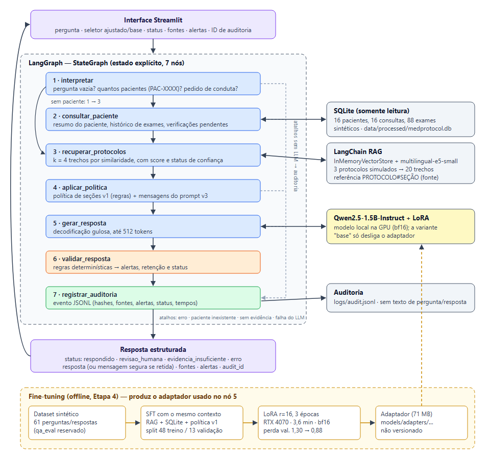

# MedProtocol AI

Assistente educacional de consulta a protocolos hospitalares, desenvolvido para o
**Tech Challenge Fase 3 — FIAP PosTech IA para Devs**.

> ⚠️ Protótipo educacional. Todos os protocolos, pacientes e exames são **sintéticos**.
> O sistema não diagnostica, não prescreve e não substitui avaliação profissional.
> Nada foi revisado por profissional de saúde.

## Demonstração

[](https://www.youtube.com/watch?v=VpMtM8cumbI)

Vídeo da entrega (cerca de 13 minutos): fine-tuning, fluxo LangGraph, perguntas na interface, logs e validação. [Assistir no YouTube](https://www.youtube.com/watch?v=VpMtM8cumbI).

## Objetivo

Apoiar a consulta a protocolos institucionais **simulados** de acompanhamento de pacientes com
diabetes mellitus tipo 2, num hospital fictício. O projeto combina:
- um LLM ajustado por fine-tuning (LoRA);
- recuperação de protocolos com fontes (LangChain);
- dados estruturados de pacientes (SQLite);
- um fluxo explícito com validação e auditoria (LangGraph).

Especificação: [`docs/PROJECT_SPEC.md`](docs/PROJECT_SPEC.md).

## Funcionalidades

**O assistente:**
- responde sobre os protocolos, citando a seção (`PROT-DM2-001#S3`);
- consulta o paciente no SQLite e informa último exame, histórico, o que está em dia, vencido,
  ausente ou fora da meta;
- aponta falta de informação, sem estimar valores;
- recusa prescrição e diagnóstico e encaminha ao médico responsável.

**Validação e rastreabilidade:**
- Cada resposta passa por **validação determinística**. Alerta alto → resposta **retida**;
  alerta médio ou gatilho clínico → **revisão humana**.
- Cada execução vira um **evento de auditoria** (JSONL, sem o texto da pergunta e da resposta).

**Interface Streamlit:**
- status, resposta, fontes, alertas e ID de auditoria;
- seletor modelo ajustado/base.

**Fora do escopo:** dados reais, uso clínico, prescrição automatizada, mobile e produção.

## Resultados em uma frase

O fine-tuning LoRA foi real (Qwen2.5-1.5B, RTX 4070) e reduziu a perda, mas, na avaliação final
reservada, **o modelo ajustado não demonstrou superioridade sobre o base**.
- Leitura cega com 10 exemplos: 3/4/3 × 2/2/6 (correta/parcial/incorreta); p ≈ 0,38.
- A heurística de status de exame aponta o contrário.
- A camada de validação reteve as respostas perigosas e **nenhuma resposta incorreta saiu como
  aprovada** nesse conjunto, mas ela tem falhas conhecidas.

Detalhes: [`docs/AVALIACAO_FINAL.md`](docs/AVALIACAO_FINAL.md).

## Arquitetura



O fluxo vai de Streamlit para LangGraph (7 nós). O grafo consulta o SQLite e o RAG LangChain,
aplica a política de seções, gera com Qwen2.5 + LoRA, valida e registra a auditoria, devolvendo
uma resposta estruturada. Fonte vetorial: [`docs/arquitetura.svg`](docs/arquitetura.svg).
Grafo, regras e status: [`docs/ARCHITECTURE.md`](docs/ARCHITECTURE.md).

| Área | Tecnologia |
|---|---|
| Linguagem e testes | Python 3.14 (≥ 3.11), pytest |
| Dados estruturados | SQLite |
| Recuperação | LangChain (`InMemoryVectorStore`, `HuggingFaceEmbeddings`) + `multilingual-e5-small` (CPU) |
| Fine-tuning | PyTorch CUDA, Transformers, PEFT (LoRA bf16); Qwen2.5-1.5B-Instruct |
| Integração da LLM e do banco | LangChain: `BaseChatModel` sobre o Qwen2.5 + LoRA (cadeia LCEL) e consulta SQLite como `Runnable` |
| Orquestração | LangGraph (estado explícito, validação determinística, auditoria) |
| Interface | Streamlit |

## Entregáveis

| Entregável | Onde |
|---|---|
| Relatório técnico | [`docs/RELATORIO_TECNICO.md`](docs/RELATORIO_TECNICO.md) |
| Avaliação final (base × ajustado) | [`docs/AVALIACAO_FINAL.md`](docs/AVALIACAO_FINAL.md), [`reports/eval_final/`](reports/eval_final/) |
| Checklist dos requisitos da FIAP | [`docs/CHECKLIST_FIAP.md`](docs/CHECKLIST_FIAP.md) |
| Diagrama de arquitetura | [`docs/arquitetura.svg`](docs/arquitetura.svg) / [`.png`](docs/arquitetura.png) |
| Vídeo da demonstração | [YouTube](https://www.youtube.com/watch?v=VpMtM8cumbI) |
| Pipeline de fine-tuning | `scripts/build_sft_dataset.py`, `split_sft_dataset.py`, `train_lora.py`, `compare_models.py`; [`docs/FINETUNING.md`](docs/FINETUNING.md) |
| Integração LangChain (RAG) | `src/medprotocol/rag/`; [`docs/RAG.md`](docs/RAG.md) |
| Fluxo LangGraph | `src/medprotocol/graph/`; [`docs/ARCHITECTURE.md`](docs/ARCHITECTURE.md) |
| Dataset sintético | `data/`; [`data/DATASET_CARD.md`](data/DATASET_CARD.md) |

## Instalação

Testado em **Windows 11 + NVIDIA RTX 4070 (12 GB) + Python 3.14.4**. São dois ambientes, para
que a troca de torch (CPU × CUDA) não altere os limiares calibrados do RAG:

| Ambiente | Conteúdo | Uso |
|---|---|---|
| `.venv` | torch CPU + RAG | Dados, banco, índice e avaliação do RAG; testes sem GPU |
| `.venv-train` | torch CUDA + RAG + LangGraph + PEFT + Streamlit | Treino, fluxo com modelo real, interface, avaliação final |

```powershell
# 1. Ambiente de dados/RAG (CPU)
python -m venv .venv
.venv\Scripts\python -m pip install -e ".[dev,rag]" -c constraints-rag.txt
copy .env.example .env                     # opcional: os padrões já funcionam; nunca versione o .env

# 2. Ambiente de treino/inferência (GPU)
py -3.14 -m venv .venv-train
.venv-train\Scripts\python -m pip install torch==2.14.1+cu130 --index-url https://download.pytorch.org/whl/cu130
.venv-train\Scripts\python -m pip install -e ".[dev,train,rag,graph,ui]" -c constraints-train.txt
```

**Downloads no primeiro uso:**
- ~470 MB do modelo de embeddings;
- ~3,1 GB do Qwen2.5-1.5B-Instruct (Apache-2.0).

Não há chave de API. As configurações por variável de ambiente estão em
[`.env.example`](.env.example).

## Execução

Todos os comandos são executados a partir da raiz do repositório.

### Preparar dados (uma vez)

```powershell
.venv\Scripts\python scripts/validate_dataset.py      # validador do dataset sintético
.venv\Scripts\python scripts/build_database.py        # data/processed/medprotocol.db (não versionado)
.venv\Scripts\python scripts/build_index.py           # data/vectorstore/ (não versionado)
.venv\Scripts\python scripts/build_sft_dataset.py     # data/processed/sft/train.jsonl
```

### Treinar o adaptador LoRA (cerca de 4 min na RTX 4070)

```powershell
.venv-train\Scripts\python scripts/train_lora.py --config configs/finetune/qwen2.5-1.5b-lora-v1.json --smoke   # 2 passos
.venv-train\Scripts\python scripts/train_lora.py --config configs/finetune/qwen2.5-1.5b-lora-v1.json
.venv-train\Scripts\python scripts/compare_models.py --config configs/finetune/qwen2.5-1.5b-lora-v1.json        # validação interna
```

O adaptador vai para `models/adapters/` (**não versionado**; é preciso treinar para usar o
sistema). Os relatórios ficam em `reports/finetune/`.

### Usar o assistente

```powershell
.venv-train\Scripts\python -m streamlit run app/streamlit_app.py          # interface em http://localhost:8501
.venv-train\Scripts\python scripts/ask.py "Quando está prevista a próxima HbA1c de PAC-0001?"   # linha de comando (JSON)
.venv-train\Scripts\python scripts/ask.py --variant base "..."            # modelo-base (adaptador desligado)
```

Perguntas de demonstração: [`scripts/demo/perguntas.txt`](scripts/demo/perguntas.txt).
A auditoria vai para `logs/audit.jsonl`.

### Avaliações

```powershell
.venv\Scripts\python scripts/evaluate_retrieval.py                       # RAG, conjunto de desenvolvimento
.venv-train\Scripts\python scripts/ui_e2e.py --variants ajustado base    # teste real da interface
.venv-train\Scripts\python scripts/evaluate_final.py --report            # recalcula o resumo da avaliação final (sem GPU)
```

A avaliação final (`evaluate_final.py --run`) **já foi executada uma vez** sobre o
`qa_eval.jsonl`, sob protocolo congelado. O script recusa uma nova execução.

## Testes

```powershell
.venv-train\Scripts\python -m pytest       # 254 testes (inclui interface e avaliação)
.venv\Scripts\python -m pytest             # sem Streamlit: os testes de interface são pulados
```

Nenhum teste precisa de GPU: o LLM é simulado nos testes do fluxo e da interface. O modelo real
é exercitado por `scripts/ask.py`, `scripts/ui_e2e.py` e `scripts/evaluate_final.py`.

## Estrutura

```
app/                 interface Streamlit
src/medprotocol/     pacote: config, data, db, rag, finetuning, graph, ui, evaluation
scripts/             scripts que orquestram cada etapa (ver scripts/README.md)
tests/               testes pytest
data/                dados sintéticos: protocolos, pacientes, exames, perguntas (DATASET_CARD.md)
configs/finetune/    configuração do treino LoRA
reports/             evidências versionadas: treino, comparação, demo, interface, avaliação final
docs/                relatório, avaliação, checklist, arquitetura e documentação técnica
```

**Não versionados (`.gitignore`):**
- ambientes virtuais;
- `.env`;
- banco e índice (regeneráveis);
- pesos e adaptadores (`/models/`, `*.safetensors`);
- `logs/`.

## Limitações

- **O modelo ajustado não é confiável:** troca exames, erra status de prazo e às vezes inventa
  informação. A melhora do fine-tuning foi de estilo, não de fidelidade.
- **Validação por regras textuais:**
  - retém ou encaminha a maioria dos erros, mas não todos;
  - deixou passar um "Não suspenda a insulina NPH" (exibido como pendente de revisão);
  - reteve uma resposta correta por "não oferecer nada por via oral";
  - "respondido" não garante que a resposta esteja completa.
- **Amostras pequenas:** 61 exemplos de treino, 13 de validação e 10 de avaliação. Não há
  significância estatística. A revisão técnica foi feita por IA, sem revisão clínica.
- **Não há modelos de laudos e receitas** no dataset (ver checklist).
- **Infraestrutura mínima:**
  - um ambiente testado (Windows + RTX 4070);
  - auditoria em arquivo local;
  - interface sem autenticação (só `localhost`).

Lista completa: [`docs/RELATORIO_TECNICO.md`](docs/RELATORIO_TECNICO.md) §9.

## Histórico das etapas

- [x] **Etapa 0** — Fundação (estrutura, configuração, testes)
- [x] **Etapa 1** — Dataset sintético v1 ([`data/DATASET_CARD.md`](data/DATASET_CARD.md))
- [x] **Etapa 2** — SQLite e funções de consulta ([`docs/DATABASE.md`](docs/DATABASE.md))
- [x] **Etapa 3** — Recuperação de protocolos com LangChain ([`docs/RAG.md`](docs/RAG.md))
- [x] **Etapa 4** — Fine-tuning LoRA real e comparação na validação interna ([`docs/FINETUNING.md`](docs/FINETUNING.md))
  - lote piloto de 41 exemplos (61 no total) e split 48/13 sem paciente nos dois lados;
  - perda 1,30 → 0,88, mas o ajustado **não ficou mais correto** na leitura;
  - a iteração de dados/treino proposta **não foi feita**; o modelo avaliado é o v1.
- [x] **Etapa 5** — Fluxo LangGraph com validação determinística e auditoria ([`docs/ARCHITECTURE.md`](docs/ARCHITECTURE.md))
- [x] **Etapa 6** — Interface Streamlit (19 testes + teste real de 16 perguntas)
- [x] **Etapa 7** — Avaliação final única no `qa_eval`, relatório, diagrama e checklist

## Pendências que dependem do desenvolvedor

- [x] Gravar o vídeo (até 15 min). Publicado: [YouTube](https://www.youtube.com/watch?v=VpMtM8cumbI).
- [x] LLM customizada e consulta SQLite como componentes LangChain (`src/medprotocol/graph/lc_components.py`).
- [ ] Aceitar como limitação (ou não) o item **parcial** da [checklist](docs/CHECKLIST_FIAP.md):
  modelos de laudos/receitas fora do dataset.
- [ ] Confirmar se a entrega individual é aceita (o enunciado fala em grupo).
- [ ] Revisar o relatório e fazer `git push`.
