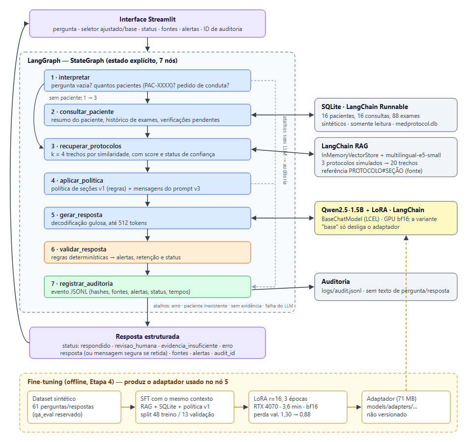

# MedProtocol AI — Relatório técnico

**Tech Challenge Fase 3 — FIAP PosTech IA para Devs** · novembro de 2026

> Protótipo educacional. Protocolos, pacientes e exames são **sintéticos**. Nada foi revisado por
> profissional de saúde. O sistema não diagnostica, não prescreve e não substitui avaliação médica.

**Resumo.** O MedProtocol AI é um assistente de consulta a protocolos hospitalares simulados de
acompanhamento de diabetes tipo 2. Ele combina:
- um LLM pequeno ajustado com LoRA (Qwen2.5-1.5B-Instruct);
- recuperação de protocolos com LangChain;
- dados estruturados de pacientes em SQLite;
- um fluxo LangGraph com validação determinística e auditoria;
- uma interface Streamlit.

O fine-tuning foi real e reduziu a perda, mas **o modelo ajustado não demonstrou superioridade
sobre o base** na avaliação final reservada. A camada de validação impediu que respostas
incorretas fossem apresentadas como aprovadas, mas tem falhas conhecidas.

## 1. Problema e objetivo

O enunciado pede um assistente médico treinado com dados do hospital, capaz de responder dúvidas
de médicos com base em protocolos internos e de organizar fluxos automatizados e seguros. Um
exemplo é verificar exames pendentes e emitir alertas.

**Recorte escolhido:**
- **Domínio:** acompanhamento ambulatorial e hospitalar de diabetes tipo 2, em hospital fictício.
- **O assistente faz:**
  - responde sobre protocolos, citando a seção;
  - consulta os dados do paciente e calcula o que está em dia, vencido, ausente ou fora da meta;
  - aponta falta de informação;
  - recusa prescrição e diagnóstico, encaminhando ao médico responsável;
  - registra cada execução para auditoria.
- **Fora do escopo:** dados reais, uso clínico, prescrição, diagnóstico e infraestrutura de
  produção.

**Requisitos do enunciado × implementação:** ver `docs/CHECKLIST_FIAP.md`.

## 2. Arquitetura

(Fonte vetorial: `docs/arquitetura.svg`.)

| Camada | Tecnologia | Código |
|---|---|---|
| Interface | Streamlit 1.67 | `app/streamlit_app.py`, `src/medprotocol/ui/` |
| Orquestração | LangGraph 1.2 (`StateGraph`, 7 nós) | `src/medprotocol/graph/workflow.py` |
| Recuperação | LangChain (`InMemoryVectorStore`, `HuggingFaceEmbeddings`) + `multilingual-e5-small` | `src/medprotocol/rag/` |
| Dados estruturados | SQLite (somente leitura na inferência) | `src/medprotocol/db/` |
| Contexto | Política de seções v1 + prompt v3 (os mesmos do treino) | `src/medprotocol/finetuning/context*.py`, `messages.py` |
| LLM | Qwen2.5-1.5B-Instruct + adaptador LoRA, local, GPU, exposto como `BaseChatModel` LangChain | `src/medprotocol/graph/llm.py`, `lc_components.py` |
| Validação | Regras determinísticas, sem LLM | `src/medprotocol/graph/validation.py` |
| Auditoria | JSONL, texto só como hash | `src/medprotocol/graph/audit.py` |
| Avaliação | Métricas em 3 níveis | `src/medprotocol/evaluation/`, `scripts/evaluate_final.py` |

**Decisão central:** o modelo vê, na inferência, exatamente o mesmo formato de contexto que viu
no treino. Isso inclui os trechos recuperados, as seções escolhidas por regra e o JSON do
paciente. As mesmas funções geram os dois.

## 3. Dataset sintético e cuidados com dados

| Conjunto | Registros |
|---|---|
| Protocolos simulados (`PROT-DM2-001..003`) | 3 (acompanhamento ambulatorial, hipoglicemia hospitalar, rastreamento de complicações) |
| Pacientes · consultas · exames | 16 · 16 · 88 |
| Perguntas/respostas de treino | 61, em 7 categorias |
| Perguntas/respostas de avaliação (reservadas) | 10 |

**Como os dados foram criados:**
- Escritos do zero, com assistência de IA. Nenhum dado real serviu de ponto de partida.
- Os protocolos declaram `natureza_regras: simulada` e `validacao_clinica: nao_realizada`.

**Proteção de dados:**
- Sem nome, CPF, cartão SUS ou contato; só o ano de nascimento; IDs artificiais.
- O validador rejeita colunas extras e procura padrões de CPF, SUS, e-mail, telefone e CEP.
- Essa busca é verificação adicional, não prova de anonimização: a garantia vem da origem
  sintética.

**Curadoria:**
- O validador confere evidências, datas e regras temporais contra os CSVs.
- Revisão manual dos 61 exemplos (3 corrigidos no v1).
- Lote piloto com contexto pré-registrado antes de existirem respostas.
- Revisão técnica; **não houve revisão clínica**.

**Isolamento da avaliação:**
- Os pacientes PAC-0009 e PAC-0010 e as seções `PROT-DM2-002#S4` e `PROT-DM2-003#S4` só aparecem
  na avaliação.
- O código de treino rejeita esses dados com erro explícito.
- O validador mede a similaridade treino × avaliação (máximo 0,538).

Detalhes: `data/DATASET_CARD.md`, `docs/FINETUNING_DATA.md`.

## 4. RAG com LangChain e SQLite

**Recuperação:**
- Os 3 protocolos são divididos por seção (20 trechos) e indexados com `multilingual-e5-small`
  (CPU, sem chave de API), cada trecho com referência `PROTOCOLO#SEÇÃO`.
- A busca devolve k = 4 trechos com score e um status de confiança. Os limiares foram calibrados
  num conjunto de desenvolvimento próprio, nunca no `qa_eval`.
- No conjunto de desenvolvimento (22 perguntas no escopo): **Hit@1 0,864, Hit@3 0,955, MRR 0,914**.
- O score não separa bem perguntas fora do escopo que usam o vocabulário do domínio. Por isso
  existem limiares de faixa e a política de seções.

**Política de seções v1:**
- Regras determinísticas acrescentam seções que a busca pode perder. Exemplos: a seção de revisão
  humana quando há pedido de conduta; as de periodicidade quando a pergunta cita paciente.
- Na avaliação final, 92% das referências esperadas estavam no contexto entregue ao modelo.

**SQLite:**
- Gerado de forma atômica e reproduzível a partir dos CSVs, depois do validador.
- Guarda os hashes das fontes.
- `get_patient_summary` calcula, na data de referência (30/06/2026), o último exame de cada tipo,
  o histórico, a próxima verificação, os status (em dia/vencido/ausente) e o que está fora da meta.

Detalhes: `docs/RAG.md`, `docs/DATABASE.md`.

## 5. Fine-tuning LoRA

| Item | Valor |
|---|---|
| Modelo-base | `Qwen/Qwen2.5-1.5B-Instruct` (Apache-2.0), revisão `989aa79…` |
| Por quê | Licença livre, bom português, cabe com folga em 12 GB. Llama e Gemma exigem aceite; o Qwen 3B tem licença restritiva |
| Hardware | RTX 4070 12 GB, Windows 11, Python 3.14, torch 2.14.1+cu130, transformers 5.21.1, peft 0.21.3 |
| Método | LoRA bf16 (não QLoRA: `bitsandbytes` é frágil no Windows e desnecessário aqui) |
| LoRA | r = 16, alpha = 32, dropout = 0,05, em q/k/v/o/gate/up/down: 18,5 M parâmetros treináveis (1,18%) |
| Treino | 3 épocas, lote efetivo 8, taxa 2e-4, aquecimento 10%, semente 42, até 6.144 tokens |
| Dados | 48 treino / 13 validação, sem paciente nos dois lados; perda só na resposta do assistente |
| Execução | 214 s, pico de 4,9 GB na GPU |
| Perda de validação | 1,299 → **0,882** (época 3, escolhida) |

**Comparação na validação interna (Etapa 4, 13 exemplos):**
- A perda caiu.
- O ajustado aprendeu formato, recusa e encaminhamento.
- Na leitura manual, porém, ficou com 1 correta, 7 parciais e 5 incorretas, contra 4, 5 e 4 do
  base. **Não ficou mais correto.**

Evidências: `reports/finetune/qwen2.5-1.5b-lora-v1/`, `docs/FINETUNING.md`.

## 6. LangGraph, validação e auditoria

**Grafo:**
- Sete nós: `interpretar` → `consultar_paciente` → `recuperar_protocolos` → `aplicar_politica` →
  `gerar_resposta` → `validar_resposta` → `registrar_auditoria`.
- Arestas condicionais criam atalhos que **não chamam o LLM**: pergunta vazia, mais de um
  paciente, paciente inexistente, nenhuma evidência confiável. Falhas de banco ou modelo viram
  status `erro`, sem derrubar o processo.
- Componentes LangChain nos nós (`src/medprotocol/graph/lc_components.py`):
  - `consultar_paciente` invoca um `RunnableLambda` que lê o SQLite em modo somente leitura;
  - `gerar_resposta` invoca a cadeia LCEL `mensagens → MedProtocolChatModel → StrOutputParser`.
    `MedProtocolChatModel` é um `BaseChatModel` sobre o Qwen2.5 + LoRA.
  - A mudança não alterou o prompt: as 16 respostas da demonstração (`reports/graph/demo_*.jsonl`),
    regeradas na GPU depois dela, ficaram idênticas.

**Validação (sem LLM):**
- Confere o texto gerado contra o contexto: IDs de exames de outro paciente, exame ou valor
  trocado, data ou referência fora do contexto, dose não fornecida, sugestão de conduta, recusa
  ausente, conduta por via oral incompatível com a condição, fonte externa e afirmação de ação não
  registrada.
- Alerta alto → a resposta é **retida** e substituída por mensagem segura. O texto original fica
  disponível só para revisão técnica.
- Alerta médio ou gatilho clínico (pedido de conduta, resultado fora da meta, dados
  inconsistentes) → `revisao_humana`.

**Auditoria:**
- Um evento JSONL por pergunta: ID, modelo e variante, versão do prompt, paciente, fontes,
  alertas, status, se foi retida e tempos por nó.
- Pergunta e resposta entram só como SHA-256, para não espalhar dados.

Detalhes: `docs/ARCHITECTURE.md`.

## 7. Interface Streamlit

A interface mostra:
- campo de pergunta e seletor ajustado/base (o mesmo modelo carregado, com o adaptador ligado ou
  desligado);
- status colorido;
- resposta ou, se retida, a mensagem segura, com o texto original num expansor "NÃO VALIDADO";
- tabelas de alertas e fontes;
- ID de auditoria;
- aviso educacional fixo.

Antes de carregar o modelo, a interface verifica banco, índice, adaptador e GPU e mostra
mensagens sem stack trace.

**Verificação:**
- 19 testes com assistente simulado.
- Teste real de ponta a ponta com 16 perguntas, com resultados idênticos aos da linha de comando
  (`reports/ui/`).

## 8. Avaliação base × ajustado

**Protocolo.** Avaliação **única** no conjunto reservado, nas condições abaixo:
- protocolo congelado e commitado antes da execução: hashes de 19 arquivos do sistema e 7
  checagens de vazamento, todas aprovadas;
- mesmo fluxo, mesmo contexto (conferido por hash) e decodificação gulosa;
- três níveis de métrica: texto bruto, sistema e leitura técnica cega.

| | Base | Ajustado |
|---|---|---|
| Leitura cega: correta / parcial / incorreta | 2 / 2 / 6 | 3 / 4 / 3 |
| Status de exame correto (heurística) | 10/16 | 6/16 |
| Registros EX/CON esperados citados | 0,00 | 0,33 |
| Perda nas respostas esperadas | 1,413 | 0,939 |
| Sistema: retidas · `revisao_humana` · `respondido` | 2 · 9 · 1 | 3 · 9 · 1 |
| Incorretas exibidas como `respondido` | 0 | 0 |

**Leitura dos resultados:**
- **O modelo ajustado não superou o base de forma demonstrável.**
  - A leitura cega favorece o ajustado (4 vitórias, 1 derrota, 5 empates; p ≈ 0,38), mas a
    heurística de status favorece o base.
  - Com 10 exemplos e um revisor de IA, nenhuma das duas direções é evidência.
  - O que se observa com segurança é o mesmo da Etapa 4: o LoRA mudou estilo e comportamento de
    superfície, e a fidelidade aos dados continua fraca nos dois.
- **Os dois produziram respostas perigosas,** retidas pela validação: carboidrato por via oral a
  paciente que não deglute (ajustado) e prescrição de dose (base).
- **A validação é a principal proteção,** mas imperfeita.
  - Nenhuma das 9 respostas incorretas foi exibida como aprovada.
  - Um "Não suspenda a insulina NPH" passou, com status de revisão, sem ser retido.
  - Uma resposta correta foi retida por mencionar "não oferecer nada por via oral".
  - O encaminhamento 6/6 é pouco informativo: os pacientes da avaliação têm resultados fora da
    meta, o que já força revisão.
  - **"Respondido" não garante correção.** Fora do `qa_eval`, na demonstração da Etapa 5, uma
    resposta sobre a frequência da HbA1c saiu como `respondido` omitindo os intervalos de 90/180
    dias. A validação não verifica se a resposta está completa (`docs/ARCHITECTURE.md` §6).

Resultados completos e limitações: `docs/AVALIACAO_FINAL.md`, `reports/eval_final/`.

## 9. Limitações

- **Dados pequenos e de autoria única:** 61 exemplos de treino, 13 de validação e 10 de
  avaliação. Nenhuma métrica tem poder estatístico.
- **Sem revisão clínica.** Protocolos e respostas de referência são plausíveis, não validados.
- **Avaliação por revisor de IA** envolvido na construção. As heurísticas reconhecem palavras,
  não coerência.
- **Modelo pequeno (1,5 B)** escolhido pelo hardware. Erra fatos mesmo com o dado no contexto.
- **Validação por regras textuais:**
  - não cobre todas as formas de conduta (imperativo negativo);
  - não trata negação ("não oferecer… via oral");
  - associa valores a exames por janela de texto.
- **Não há modelos de laudos e receitas** no dataset (ver checklist).
- **Auditoria em arquivo local,** sem rotação nem controle de acesso; interface sem autenticação
  (restrita a `localhost`).
- **Um ambiente testado:** Windows 11 + RTX 4070. Não foi testado em Linux nem em outras GPUs.

## 10. Melhorias futuras

1. **Mais dados de treino**, em lote pré-registrado, voltados aos erros vistos: troca de exames,
   status de prazo, informação inventada e imperativos de conduta.
2. **Avaliação maior e revisada por profissional de saúde**, com novo conjunto reservado (este já
   foi usado).
3. **Validação:**
   - tratar negação e imperativos;
   - checar coerência de status contra o resumo do paciente (a informação já existe no SQLite);
   - medir precisão e recall das regras num conjunto rotulado.
4. **Incluir modelos de laudos e de procedimentos** no dataset; receitas, apenas como documentos
   a explicar, nunca a gerar.
5. **Comparar com um modelo maior** (3–8 B, com QLoRA) para separar o efeito do tamanho do efeito
   do fine-tuning.

## 11. Conclusão

O projeto entrega um pipeline completo e reproduzível:
- dados sintéticos com curadoria e isolamento da avaliação;
- recuperação com fontes;
- dados do paciente em SQLite;
- fine-tuning LoRA real;
- fluxo LangGraph explícito, com validação e auditoria;
- interface demonstrável;
- uma avaliação final executada uma única vez sob protocolo congelado.

O resultado mais importante é negativo e foi mantido assim. Com 48 exemplos e um modelo de 1,5 B,
o fine-tuning ensinou formato e postura (recusar, encaminhar), mas **não tornou o modelo
confiável nem demonstravelmente melhor que o base**. A segurança do sistema vem sobretudo da
arquitetura em volta do modelo:
- contexto controlado;
- regras de validação que retêm ou encaminham;
- rastreabilidade de cada resposta.

Essa arquitetura também falha em casos conhecidos e documentados. Por isso, nenhuma resposta do
sistema dispensa o médico responsável.

## Reprodutibilidade

Os comandos de cada etapa estão no `README.md`. Versões em `constraints-train.txt` e
`constraints-rag.txt`. Testes: 254 (`python -m pytest` no `.venv-train`).
